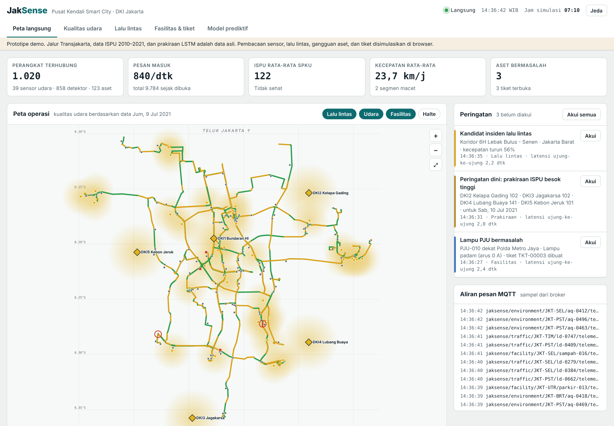
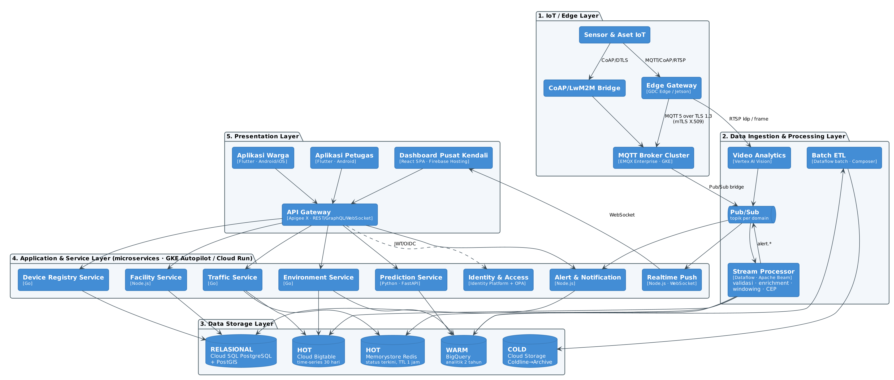

# JakSense: Smart City Monitoring System (SCMS) DKI Jakarta



**JakSense** adalah prototipe dashboard *Pusat Kendali* untuk **Smart City Monitoring System (SCMS)** DKI Jakarta. Repositori ini juga memuat dossier analisis dan desain lengkapnya.

Proyek ini dikerjakan untuk Final Project mata kuliah **Analisis dan Desain Perangkat Lunak**, Program Studi Magister Ilmu Komputer, Universitas Budi Luhur.

| | |
|---|---|
| Penyusun | Iswijayanto |
| Dosen pengampu | Assoc. Prof. Dr. Setyawan Widyarto |
| Kode proyek | SAD-MSC-2024-SCMS |
| Cloud provider | Google Cloud Platform (region `asia-southeast2` Jakarta) |

---

## Isi repositori

```
.
├── app/                    # Aplikasi JakSense (satu file HTML mandiri)
│   └── index.html
├── docker/nginx.conf       # Konfigurasi Nginx (port 8080, header keamanan, /healthz)
├── Dockerfile              # Image nginx-unprivileged (non-root)
├── docker-compose.yml      # Menjalankan aplikasi secara lokal
├── deploy/gcp/             # Deploy ke Cloud Run (Cloud Build)
├── .github/workflows/      # CI: build, smoke test, publish image ke GHCR
├── docs/
│   ├── diagram/sumber/     # Sumber diagram (PlantUML .puml, Graphviz .dot)
│   ├── diagram/gambar/     # Hasil render diagram (PNG)
│   └── screenshot/         # Tangkapan layar aplikasi
```

## Fitur aplikasi

| Tampilan | Isi |
|---|---|
| **Peta langsung** | Peta koridor Transjakarta, sensor kualitas udara, dan aset fasilitas; peringatan real-time; aliran pesan MQTT `scms/{domain}/{zona}/{device}/telemetry` |
| **Kualitas udara** | Prakiraan ISPU 24 jam (H+1) per stasiun dengan model LSTM, tren bulanan 2010–2021, peringatan dini bila prakiraan > 90 |
| **Lalu lintas** | Kecepatan per koridor, prakiraan 1 jam, deteksi insiden (aturan CEP: kecepatan turun > 50% dalam 2 menit) |
| **Fasilitas & tiket** | Tiket pemeliharaan otomatis dengan state machine Baru → Ditugaskan → Dikerjakan → Selesai → Ditutup |
| **Model prediktif** | Hasil evaluasi model (Persistence, ARIMA, Random Forest, XGBoost, LSTM) dan fitur terpenting |

> **Catatan data:** jaringan koridor dan halte Transjakarta, data ISPU 2010–2021 (Satu Data Jakarta), dan prakiraan LSTM adalah **data asli**. Pembacaan sensor, lalu lintas, gangguan aset, dan tiket **disimulasikan** di browser.

## Menjalankan aplikasi

### Dengan Docker Compose

```bash
git clone https://github.com/mbahjoyo741-png/jaksense-smart-city-monitoring.git
cd jaksense-smart-city-monitoring
docker compose up -d --build
```

Buka <http://localhost:8080>. Health check tersedia di <http://localhost:8080/healthz>.

### Dengan Docker

```bash
docker build -t jaksense .
docker run -d -p 8080:8080 --name jaksense jaksense
```

### Dari image yang sudah dipublikasikan (GHCR)

Setiap push ke `main` akan membangun image dan mempublikasikannya ke GitHub Container Registry lewat GitHub Actions:

```bash
docker run -d -p 8080:8080 ghcr.io/mbahjoyo741-png/jaksense-smart-city-monitoring:latest
```

### Tanpa Docker

`app/index.html` bisa langsung dibuka di browser, atau disajikan dengan server statis apa pun:

```bash
npx serve app        # atau: python3 -m http.server -d app 8080
```

## Deploy ke Google Cloud Run

Lihat [`deploy/gcp/README.md`](deploy/gcp/README.md). Versi singkatnya:

```bash
gcloud run deploy jaksense --source . --region asia-southeast2 --port 8080 --allow-unauthenticated
```

## Dokumen desain

Laporan Final Project tidak dipublikasikan di repositori ini. Yang disertakan adalah diagram desainnya (sumber dan hasil render) di [`docs/diagram/`](docs/diagram/): use case, C4 konteks dan kontainer, class, sequence, state machine, ERD, DFD level 0–1, pipeline stream, deployment GCP, dan pipeline MLOps.

Arsitektur kontainer (C4 Level 2):



### Merender ulang diagram

```bash
# PlantUML
java -jar plantuml.jar -tpng docs/diagram/sumber/*.puml
# Graphviz (DFD)
dot -Tpng docs/diagram/sumber/dfd1.dot -o docs/diagram/gambar/dfd1.png
```

## Lisensi

[MIT](LICENSE). Data ISPU bersumber dari portal Satu Data Jakarta, dan data rute dari GTFS Transjakarta; keduanya tunduk pada ketentuan sumber masing-masing.
